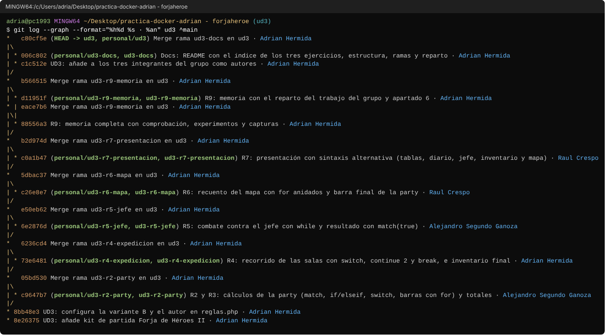
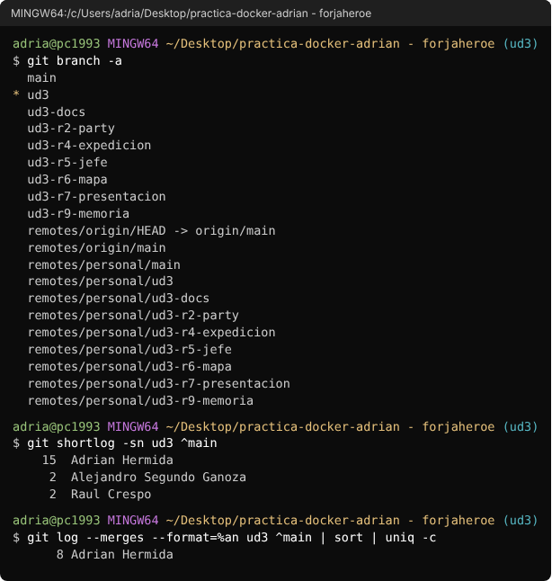
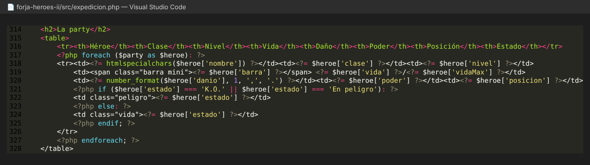
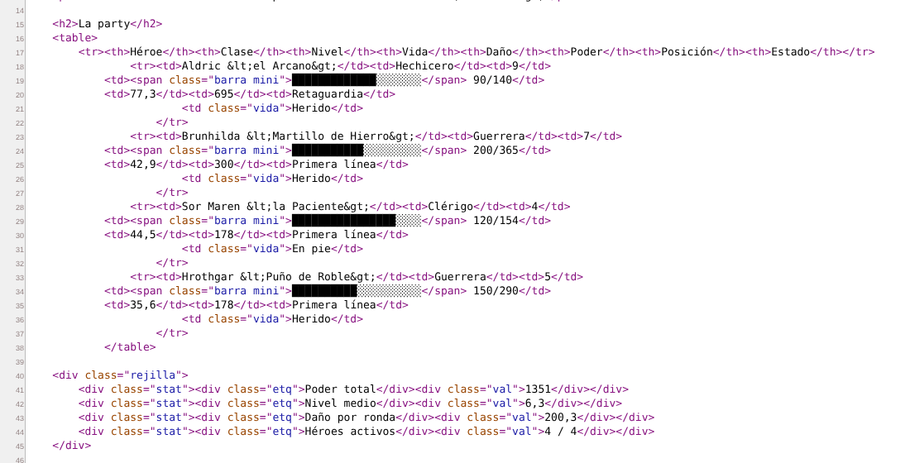
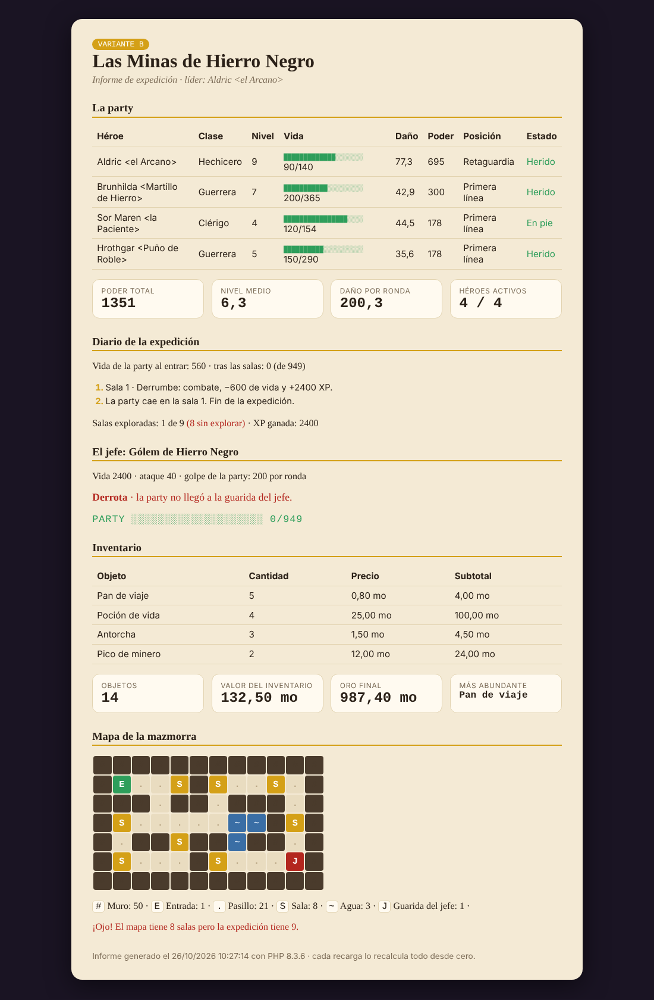
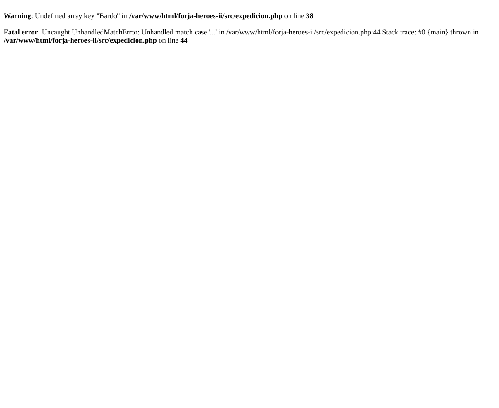
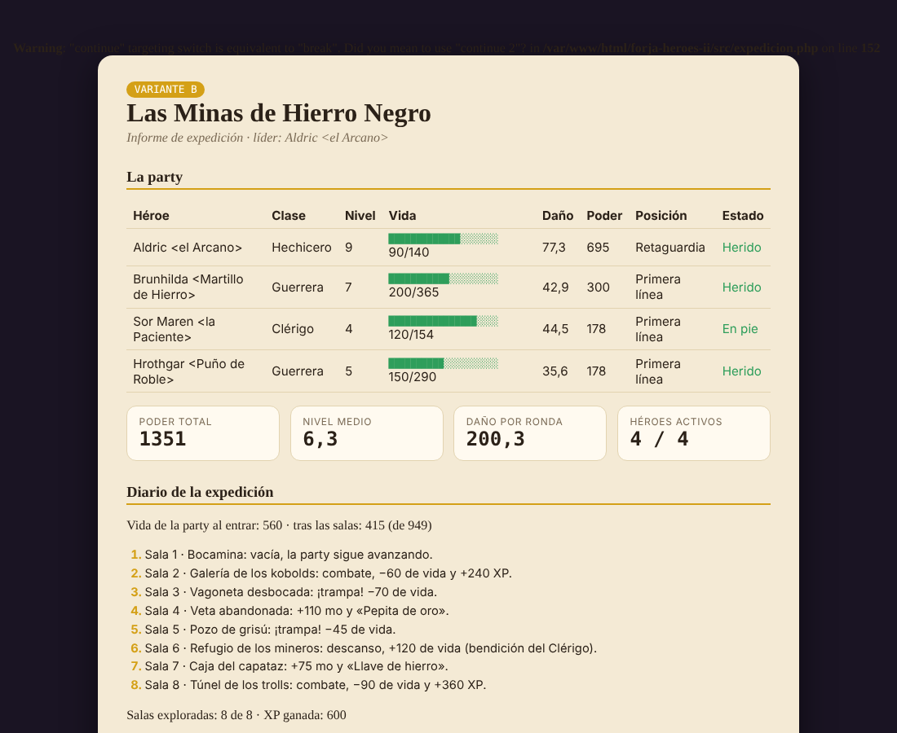

# Memoria · Tarea de refuerzo UD3 «Forja de Héroes II»

**Grupo:** Adrián Hermida Moreno · Raúl Crespo · Alejandro Segundo Ganoza
**Variante:** B (Las Minas de Hierro Negro) · **Fecha:** 26/10/2026

> Las capturas están en `capturas/`. La página se abre en el Docker en `http://localhost:8080/forja-heroes-ii/src/expedicion.php`.


## 0. Trabajo con ramas en git

1. Se creó la rama `ud3` a partir de `main` (que contiene la UD2) y se añadió el kit de partida con la variante B.
2. Cada integrante creó **su rama a partir de `ud3`** (`git checkout -b ud3-r2-party ud3`), hizo su parte y la subió (`git push`).
3. El integrador fusionó cada rama en `ud3` con **`git merge --no-ff`**. Usamos `--no-ff` para que cada fusión quede como un commit propio y en el historial se vea qué aporta cada rama, en vez de quedar todo en una línea recta.
4. `ud3` es la rama por defecto del repositorio en GitHub y contiene la versión final.

Historial de la rama `ud3` (`git log --graph`): a la izquierda la línea principal con los *merges* y a la derecha cada rama con su autor:



Ramas locales y remotas, commits por autor y quién ha hecho los *merges*:



Repositorio: https://github.com/adrianhermo93-blip/practica-docker-adrian

## 1. Comprobación de resultados

*(Todo el grupo)*

Hemos comparado nuestra página con la tabla de comprobación del enunciado para la variante B:

| Dato | Valor esperado (enunciado) | Valor de nuestra página | ¿Coincide? |
|---|---|---|---|
| Poder total de la party | 1351 (nivel medio 6,3) | 1351 (nivel medio 6,3) | Sí |
| Daño por ronda | 200,3 · golpe 200 | 200,3 · golpe 200 | Sí |
| Líder | Aldric (4 héroes activos) | Aldric &lt;el Arcano&gt; (4 / 4) | Sí |
| Vida al salir de las salas | 560 · 415 (de 949) | 560 al entrar · 415 tras las salas (de 949) | Sí |
| Resultado frente al jefe (y ronda) | Retirada (8 rondas) | Retirada · tras 8 rondas el jefe sigue con 800 de vida | Sí |
| Oro final | 1.172,40 mo | 1.172,40 mo | Sí |
| Valor del inventario | 16 objetos · 257,50 mo | 16 objetos · 257,50 mo | Sí |
| Salas en el mapa | # 50 · . 21 · S 8 | # 50 · . 21 · S 8 (mapa coherente) | Sí |

También coinciden los estados (Herido · Herido · En pie · Herido), las salas exploradas (8 de 8), la XP ganada (600), la vida final de la party (95, 2 bloques) y el objeto más abundante (Pan de viaje).

Para asegurarnos de que el código no estaba hecho «a medida» de la B, cambiamos `VARIANTE` a `'A'` y a `'C'`, y en las dos salen los valores de su columna de la tabla (por ejemplo, Victoria en la ronda 5 y 2.260,75 mo en la A, y 3 héroes activos con Vex de líder en la C). Luego lo dejamos otra vez en `'B'`. Con `error_reporting = E_ALL` no sale ningún Warning, Notice ni Deprecated en ninguna variante.

## 2. Bucles y documento resultante

*(Raúl Crespo · R7 presentación)*

Código del `foreach` que pinta la tabla de la party:



Lo que llega al navegador (Ctrl+U) de esa misma tabla:



- **¿Cuántas filas `<tr>` hay?** En el código solo hay **una** fila `<tr>` dentro del `foreach`, pero en el Ctrl+U salen **4 filas de héroes**, más la de cabecera con los `<th>`, que está fuera del bucle. El `foreach` se ejecuta en el servidor y repite ese trozo de HTML una vez por cada héroe de `$party`, que tiene 4.
- **¿Aparece `endforeach` o `if`?** No. En el Ctrl+U no hay nada de PHP: ni `foreach`, ni `endforeach`, ni `if`/`else`/`endif`. PHP se ejecuta en el servidor y al navegador solo le llega el HTML resultante. Por eso en cada fila solo aparece **una** de las dos celdas de estado (en la B todas son `<td class="vida">`, porque nadie está K.O. ni En peligro): el `if` ya ha decidido en el servidor cuál se pinta.
- En el Ctrl+U las sangrías salen algo descolocadas porque los espacios que hay delante de las etiquetas `<?php ... ?>` también se envían como texto.
- Los nombres salen como `&lt;el Arcano&gt;` porque pasan por `htmlspecialchars()`. Sin eso, el navegador tomaría `<el Arcano>` como una etiqueta y no lo mostraría.

## 3. Experimento: predigo el efecto de un cambio

*(Adrián Hermida · R4 expedición)*

Añadimos al principio de `$salas` en `inc/datos-B.php`:

```php
['nombre' => 'Derrumbe', 'tipo' => 'combate', 'valor' => 2400],
```

1. **Predicción** (antes de recargar):
   - Es un combate, así que la party pierde `intdiv(2400, 4)` = **600** de vida. Entra con 560, se queda en −40 y se pone a 0.
   - Después del `switch` salta la comprobación de vida y el `break` corta el `foreach`: se explorará **1 sala de 9** (8 sin explorar).
   - Jefe: como la party no tiene vida, el `if` da **Derrota** (no llegó a la guarida) y no hay combate.
   - Mapa: ahora hay 9 salas en los datos y el mapa sigue con 8 `S`, así que saldrá el **aviso de que el mapa no es coherente**.
   - Oro: no se recoge ningún tesoro ni la recompensa, se queda en 987,40 mo.
2. **Resultado real:** coincide con la predicción.

   

3. **¿Qué sentencia corta el recorrido?** El `break` que hay después del `switch`, dentro de `if ($vidaParty <= 0)`. Sale del `foreach` de las salas, por eso solo se ve una línea de sala y la de «La party cae en la sala 1». La **tabla de rondas no aparece** porque el combate con el jefe no llega a ejecutarse: se entra por la rama `Derrota` del `if`, `$rondas` se queda vacío y en el HTML la tabla está dentro de `if (count($rondas) > 0):`.
4. Quitamos la sala y dejamos los datos como al principio (lo comprobamos volviendo a mirar la tabla de comprobación).

## 4. Experimento: match frente a switch

*(Alejandro Segundo Ganoza · R2/R3 party)*

1. Cambiamos la clase de Hrothgar de `'Guerrera'` a `'Bardo'` y recargamos:

   

   Salen dos cosas:
   - Un **Warning** `Undefined array key "Bardo"` en la línea del `vidaMax`, porque `MULT_VIDA` no tiene la clave `'Bardo'`.
   - Un **Fatal error** `Uncaught UnhandledMatchError` en la línea del `match` del daño. Es una excepción que nadie captura, por eso el script se para entero y la página ya no se pinta. Se produce porque el `match` compara la clase con sus brazos (`Guerrera`, `Hechicero`, `Pícara`, `Clérigo`), ninguno es `'Bardo'` y **no tiene `default`**.
2. El `switch` de la posición le daría **'Reserva'**, porque cae en el `default`. El `switch` no falla porque, si ningún `case` coincide, ejecuta el `default` (y si no lo tuviera, simplemente no haría nada). El `match` está obligado a devolver un valor, y si no encuentra ningún brazo lanza el error. En la captura no se llega a ver «Reserva» porque el `match` del daño va antes y el script se para ahí.
3. Volvimos a poner `'Guerrera'`. En un programa real preferimos el **`match` sin `default`**: si llega un dato que no se esperaba, es mejor que el programa falle y avise que calcular un daño o una posición inventados sin que nadie se entere. El `default` del `switch` tiene sentido cuando de verdad hay un valor por defecto razonable.

## 5. Experimento: continue dentro de switch

*(Adrián Hermida · R4 expedición)*

Así está el caso `'vacía'` en el código:


1. Cambiamos `continue 2;` por `continue;` y recargamos. Aparece este aviso arriba del todo, antes que el HTML, porque PHP lo detecta al compilar el fichero y no al ejecutarlo:

   `Warning: "continue" targeting switch is equivalent to "break". Did you mean to use "continue 2"? in .../expedicion.php on line 152`

   

   (En la captura el aviso se lee mal porque PHP lo pinta en letra oscura sobre el fondo oscuro de la página.)

2. **¿Qué cambia?** En nuestro caso, el diario y el recuento de salas **no cambian**: siguen siendo 8 de 8 y las mismas 8 líneas. Lo comprobamos comparando el HTML de las dos versiones y solo cambia el Warning. Lo que cambia es a qué bucle afecta:
   - `continue 2;` afecta al **`foreach`** (el segundo nivel contando desde dentro): salta directamente a la siguiente sala y se salta lo que hay después del `switch`.
   - `continue;` afecta al **`switch`** (el primer nivel), que no es un bucle, así que hace lo mismo que `break`: sale del `switch` y sigue con lo de debajo (la comprobación de si la party ha caído). Como en una sala vacía la vida no cambia, esa comprobación no hace nada y el resultado es el mismo.
   - El recuento no cambia porque `$salasExploradas++` está **al principio** del `foreach`, antes del `switch`. Si estuviera al final, con `continue 2` las salas vacías no se contarían y saldría 7 de 8.
3. Lo dejamos otra vez con `continue 2;`, que es lo correcto y no da avisos.

## 6. Uso de IA (obligatorio declararlo)

Durante el desarrollo de esta actividad se ha utilizado inteligencia artificial como herramienta de apoyo al aprendizaje y la documentación. Su uso ha estado enfocado en comprender mejor los objetivos de la práctica, la metodología de trabajo y los conceptos relacionados con el uso de Git y las ramas de desarrollo.

Además, la inteligencia artificial se ha empleado como apoyo para la redacción de esta memoria, ayudando a mejorar la claridad del texto, la estructura de los apartados y la corrección ortográfica y gramatical, sin modificar el contenido ni los resultados obtenidos por el alumno.

También ha servido como recurso de consulta para comprender el flujo de trabajo con repositorios Git, la creación y gestión de ramas, la integración de cambios y las buenas prácticas de trabajo colaborativo. En todo momento las decisiones técnicas, la realización de la práctica y la validación de los resultados han sido responsabilidad del alumno.
